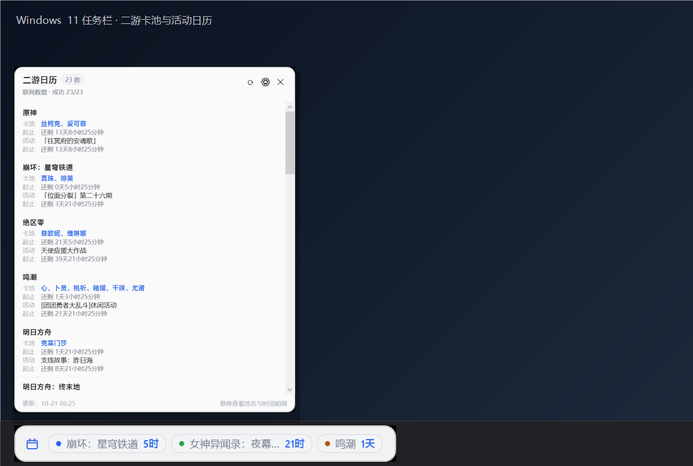
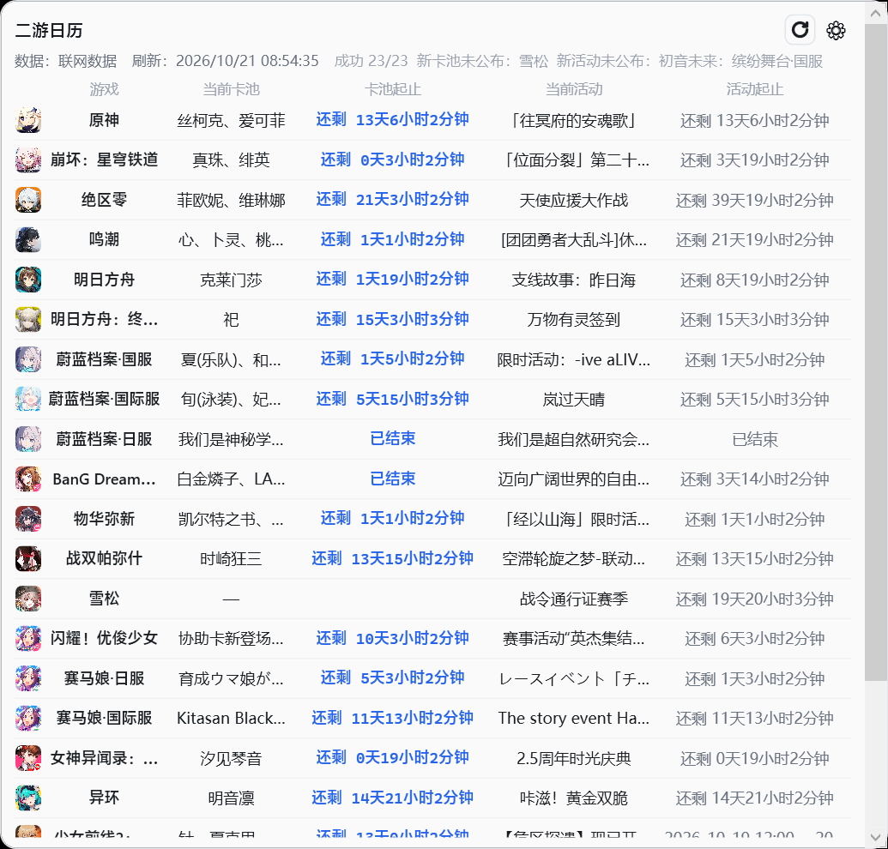
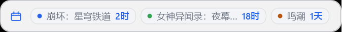
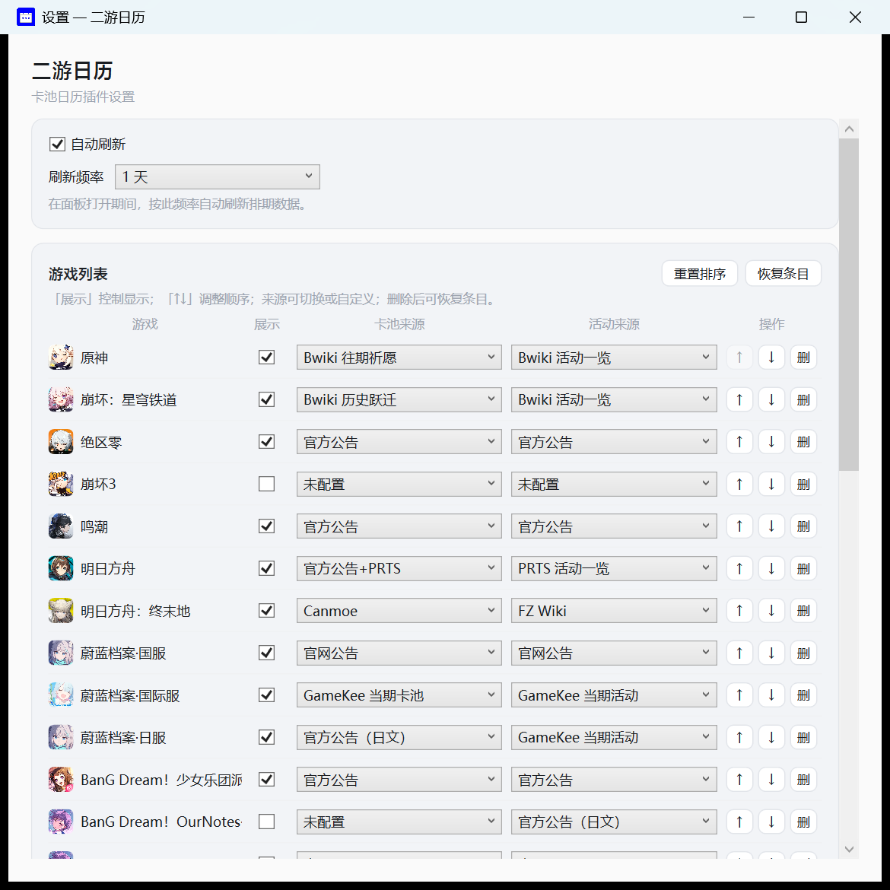

# gacha-calendar

[](https://github.com/EastMG/gacha-calendar/actions/workflows/ci.yml)
[](./LICENSE)

[](https://www.npmjs.com/package/gacha-calendar-core)

**Windows 11 任务栏左侧常驻的二游卡池 / 活动日历小组件。**

不用开浏览器、不用切窗口：任务栏上直接看到"哪款游戏快结束了、还剩多久"，
点一下展开完整的 28 款游戏日程面板。

> 与 [`dsh-gacha-calendar`](https://github.com/EastMG/dsh-gacha-calendar)（DSH 桌面端插件）、
> [`gacha-calendar-extension`](https://github.com/EastMG/gacha-calendar-extension)（浏览器扩展）
> 共用同一份抓取核心 [`gacha-calendar-core`](https://www.npmjs.com/package/gacha-calendar-core)——
> 解析器只维护一处，桌面端不重复实现抓取。

<p align="center">
  
</p>

<p align="center">
  
  &nbsp;
  
</p>

<p align="center">
  
</p>

## 当前状态

**v0.1.7 预览版**：任务栏常驻条 + DSH 风格六列面板 + 托盘 + 设置 + 单实例 + 开机自启，
应用内刷新已接通。外壳技术已拍板：**WPF**。

| 能力 | 状态 |
|---|---|
| 外壳技术 | ✅ WPF（2026-10-21 拍板，见[选型记录](docs/09-外壳选型-WPF.md)） |
| 任务栏左侧常驻条（不抢焦点、不进 Alt+Tab、高 DPI） | ✅ |
| 完整面板（28 款，默认显示 23 款，倒计时 + 悬停明细） | ✅ |
| 失败三态：报错 / 未公布 / 沿用旧数据 | ✅ |
| 系统托盘、设置、单实例、开机自启 | ✅ |
| 数据抓取 | ✅ 应用内 Node Host 调用 core（v0.1.7）；开发期仍可用 `tools/refresh.mjs` |
| 壳无关基础层（config / snapshot / Host 协议 / 视图模型） | ✅ `packages/engine/` + `packages/viewmodel/` |
| 应用内自动刷新 / 手动刷新 | ✅ v0.1.7（启动/打开面板时按 due 刷新；每分钟检查） |
| DSH 面板风格（六列表格/状态栏/图标/刷新） | ✅ v0.1.7 首版 |
| DSH 设置页（自动刷新/条目/来源/自检/自定义） | ✅ v0.1.8 |
| Fluent / DSH 交互细节与视觉回归 | 📋 待办（[#1](https://github.com/EastMG/gacha-calendar/issues/1) / [BACKLOG.md](BACKLOG.md)） |
| 多显示器、轮播、安装包 | 🚧 v0.1.10+（见[路线图](docs/04-路线图.md)） |

> 数据不会过期到"骗人"：某列抓取失败时，界面会显示「卡池失败：原因」或「沿用旧数据」，
> 不会把上一次的结果伪装成最新。

## 功能

- **任务栏常驻条**：横向显示 1–6 个"最近结束"的卡池 / 活动与短倒计时（如「鸣潮 1天」）。
- **完整面板**：按 28 款游戏展示：
  - 卡池：优先外显 UP 角色名（如「丝柯克、爱可菲」），悬停看池名与源站原文时间；
  - 起止：`还剩 X 天 X 小时 X 分钟` / `还有 X 开始` / `已结束`；
  - 活动：当期活动名；同样带起止倒计时。
- **状态可见**：顶部「联网数据 · 成功 23/23」，失败/未公布分类悬停可看逐条原因。
- **系统集成**：托盘菜单、面板内设置、开机自启、单实例（第二次启动会唤起已运行实例的面板）。
- **系统主题**：启动时跟随 Windows 深/浅色。

## 数据从哪来

```
dsh-gacha-calendar（上游仓库）
  ├─ DSH 桌面端插件
  └─ packages/core/ → gacha-calendar-core（npm，抓取/解析/缓存合并的唯一真源）
          │
          ├─ gacha-calendar-extension（浏览器扩展）
          └─ gacha-calendar（本仓库：Windows 任务栏小组件）
```

来源包括各游戏**官方公告、官方 Wiki、第三方站**（bwiki / PRTS / wiki.gg / Game8 / GameKee /
Canmoe / GachaTracker / ldshop / 小米游戏中心 等），采用克制的抓取策略。
完整来源与解析器说明见 core 的 README；本仓库不复制、不修改解析逻辑。

## 快速开始（从源码运行）

环境：Windows 11 x64、[.NET 10 SDK](https://dotnet.microsoft.com/download)、Node.js 22+（应用内刷新/图标兜底需要）。

```powershell
# 1) 构建
dotnet build src\GachaCalendar\GachaCalendar.csproj -c Release

# 2) 运行（启动时会自动通过 Node Host 刷一轮；--silent 只留常驻条）
.\src\GachaCalendar\bin\Release\net10.0-windows\GachaCalendar.exe
```

> 应用内刷新由 `packages/engine/host.mjs`（Node）负责；开发期也可手动运行
> `cd tools; npm run refresh` 生成快照。v0.1.7 起无需手动清空数据。

开发者小工具：

```powershell
# 用 PrintWindow 生成 README 截图（会自动启动应用、抓两张图后退出）
powershell -NoProfile -File tools\capture-shot.ps1

# 只跑来源自检（不写文件）
cd tools; npm run selfcheck
```

开发/测试壳无关基础层：

```powershell
npm install       # 根目录，安装 gacha-calendar-core（仅 packages/engine 与测试用）
npm test          # 34 项 config / snapshot / entries / validate / service / 调度 / host / view-model 用例
npm run check     # JS 入口语法检查

# 壳无关 CLI（不用启动 UI）
node packages/engine/cli.mjs --data-dir data entries
node packages/engine/cli.mjs --data-dir data hide genshin
node packages/engine/cli.mjs --data-dir data order hsr,genshin
node packages/engine/cli.mjs --data-dir data validate

# JSON-lines 引擎 Host（可用任何语言的外壳接入）
node packages/engine/host.mjs --data-dir data
```

运行期文件都在 `%LOCALAPPDATA%\GachaCalendar\`：

| 文件 | 用途 |
|---|---|
| `settings.json` | 设置（常驻条开关、条数、全屏隐藏、开机自启） |
| `snapshot.json` | 最近一次快照（v0.1 由工具写入；可被 `GACHA_CALENDAR_DATA` 覆盖） |
| `logs\app.log` | 本地日志，不上传 |

## 项目结构

```
src/GachaCalendar/          WPF 应用（Shell）
  Models/                   snapshot / Result JSON / 设置模型
  Services/                 任务栏几何、窗口定位、快照读取、托盘、自启、单实例、主题
  ViewModels/               RowBuilder（JSON→文案）、MainViewModel、RowVm、ChipVm
  Views/                    常驻条 / 面板 / 设置窗
packages/engine/            壳无关基础层：config / snapshot / service / JSON-lines Host（Node 参考实现）
packages/viewmodel/         跨语言视图模型：行文案/倒计时/失败三态/常驻条选择（纯 JS）
tools/refresh.mjs           开发期抓取（core → snapshot.json）
tools/capture-shot.ps1      窗口截图（PrintWindow，DPI 安全）
data/config.example.json    默认配置样例
data/sample-snapshot.json   真实抓取的示例快照（内置兜底）
docs/                       产品 / 调研 / 架构 / 路线图 / 风险 / 数据契约 / 壳无关层
```

## 技术选型（一句话版）

- Windows Shell：**C# WPF（net10.0-windows）**——本机可编译可验证，Win32 互操作直接；
- 任务栏：**置顶停靠窗**（公开 API，不注入 explorer），详见[调研](docs/02-Windows11任务栏集成调研.md)；
- 抓取：复用 **gacha-calendar-core**，v0.1 用 Node 工具，v0.1.7 用隐藏 WebView2 作为 JS 引擎；
- 详细决策记录（ADR）见[架构设计](docs/03-架构设计.md)。

## 文档

- [产品定义](docs/01-产品定义.md)
- [Windows 11 任务栏集成调研](docs/02-Windows11任务栏集成调研.md)
- [架构设计](docs/03-架构设计.md)
- [路线图](docs/04-路线图.md)
- [风险与合规](docs/05-风险与合规.md)
- [数据契约](docs/06-数据契约.md)
- [壳无关基础层](docs/07-壳无关基础层.md)
- [视图模型契约](docs/08-视图模型契约.md)
- [外壳选型（WPF）](docs/09-外壳选型-WPF.md)
- [外壳技术方案对比](docs/10-外壳技术方案对比.md)
- [BACKLOG（待办）](BACKLOG.md)

## 已知限制（v0.1）

- **应用内刷新未接入**：需要运行 `cd tools; npm run refresh` 更新数据；不跑时显示示例快照。
- **仅适配"任务栏在底部"**：Windows 11 官方只支持底部；第三方工具移动任务栏的情况 v0.1.8 处理。
- **多显示器只定位主屏任务栏**（每屏一份在 v0.1.8）。
- **与 Windows 原生"小组件"按钮同位置**：建议在「设置 → 个性化 → 任务栏」关闭「小组件」，
  避免遮挡；v0.1.8 会提供左右偏移。
- **未签名**：自行构建的 exe 可能触发 SmartScreen；v0.1.9+ 再做签名与安装包。
- 需要 .NET 10 Desktop Runtime（后续提供自包含版本）。

## 免责声明

- 本项目为非营利性质的个人项目，与各游戏厂商、发行商及官方/社区 Wiki 均不存在隶属或合作关系。
- 卡池、活动等排期数据均取自各游戏**公开的官方公告与社区 Wiki、第三方站**；名称与相关内容的版权
  归原权利方所有。本项目仅作信息聚合展示，不提供亦不存储任何游戏资源。
- 如权利人认为本项目展示的内容侵犯其合法权益，请通过 [Issue](https://github.com/EastMG/gacha-calendar/issues)
  告知，核实后将尽快删除相关内容。

## License

MIT © 2026 EastMG

[](https://github.com/deepseek-ai/deepseek-harness)
