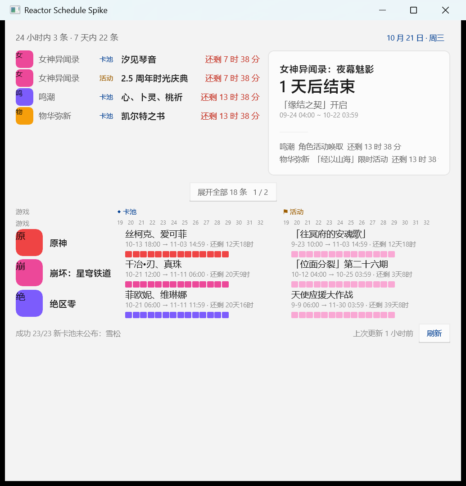

# Microsoft.UI.Reactor 隔离评估

> 状态：实验分支 `reactor-spike`，**不合并到 main**。
> 目的：验证 Reactor 能否帮助 gacha-calendar 的 newPanel/设置页，而不是重写外壳。

## 环境

- .NET SDK 10.0.100
- `Microsoft.UI.Reactor` `0.1.0-preview.16`
- `Microsoft.WindowsAppSDK` `2.3.1`
- Windows 11 / x64 / WinUI 3

Reactor 包和 Windows App SDK 包在本机 NuGet 缓存中；当前网络无法访问 nuget.org，
所以本原型用缓存包离线构建。换机器需要能还原这些包。

## 运行

```powershell
cd experiments\reactor-spike
dotnet build -p:Platform=x64
.\bin\x64\Debug\net10.0-windows10.0.22621.0\win-x64\ReactorSpike.exe
```

## 原型内容

静态复刻 newPanel 的主要结构：

- 顶部 24 小时/7 天统计 + 日期胶囊
- 近期列表（4 条/页，按钮翻页）
- 焦点卡
- 14 天刻度 + 卡池/活动条形
- 底部抓取状态 / 更新时间 / 刷新



## 实际观察

### 好的部分

- Flex/Yoga 布局写起来快，间距/行内对齐比 WPF 手写 Grid 直观；
- Hooks 的 `UseState` 翻页立即生效，声明式 UI 心智负担低；
- 原生 WinUI 3 控件、主题 token、Mica 等都是真控件/真材质；
- 单个 `Program.cs` 能表达完整面板，没有 XAML/ViewModel 样板。

### 风险与摩擦

1. **仍是实验版**
   - preview.16 的 API 与当前 README 有差异（例如 Flex 的 `RowGap`/`AlignItems`
     是 init 属性，不是链式方法）；
   - 当前 .NET SDK 10.0.100 的 Roslyn 版本低于 Reactor analyzer 期望，
     构建有 `CS9057`，Reactor 的 60+ 诊断/检查实际没运行；
   - 这意味着“编译通过”不代表 Reactor 推荐的布局/主题/无障碍规则都检查过。

2. **不是 WPF 的增量升级**
   - 这是独立的 WinUI 3 应用（`WindowsPackageType=None` + 自包含 WASDK）；
   - 现有 WPF 的任务栏置顶/无激活/托盘/窗口几何/设置页都要重做；
   - WPF 互操作在官方文档中仍是后续工作（当前主打 WinForms 宿主）。

3. **性能没有明显优势**
   - 这个静态原型启动约 **952ms**，5 秒后 working set 约 **145MB**、private 约 **98MB**；
   - 这不是和 WPF 严格对比（WPF 原型还带 Node Host），但至少说明
     “换 Reactor 就会更省内存”没有依据。

4. **视觉仍需自绘**
   - WinUI 默认 Button/CheckBox/ComboBox 风格与我们的 DSH 面板不一致；
   - 条形、焦点卡、胶囊等仍得用 Border/Flex 拼；
   - Reactor 的主题 token 能省色值管理，但并不能直接复用现有 WPF 样式。

## 结论

**不建议迁移，也不建议嵌入现有 WPF 面板。**
Reactor 值得继续观察，适合未来“从零做一个 WinUI 3 版本”的评估；
当前项目继续 WPF + 现有 Host 更稳。

如果未来要重新评估，先看：

- Reactor 是否发布稳定版（而非 preview）；
- 是否提供正式 WPF 宿主/嵌入方案；
- 任务栏/托盘/分层窗口/无激活置顶是否有稳定 API；
- 在相同数据量下，启动、常驻内存、动画帧率是否优于现有 WPF。
